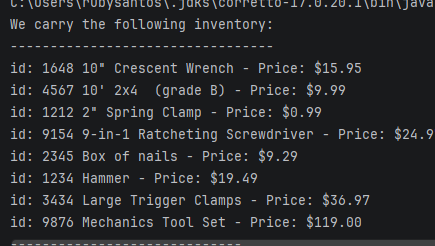

# Search Inventory

A command-line app that reads a inventory items from a file
and prints it with **all product detail**.

## Features

- Display every product
- Look up product by ID
- A friendly message if the inventory file isn't found

## How to run it

1. Open the project in IntelliJ
2. Run `App.java`
3. Type a story name, like `inventory.csv`

## Interesting code

```java
private static void printInventory(ArrayList<Product> inventory) {
    System.out.println("""
            We carry the following inventory:\s
            ---------------------------------""");
    for (int i = 0; i < inventory.size(); i++) {
        Product p = inventory.get(i);
        System.out.println(p.toPriceFormat());
    }
}
```

## Screenshot


